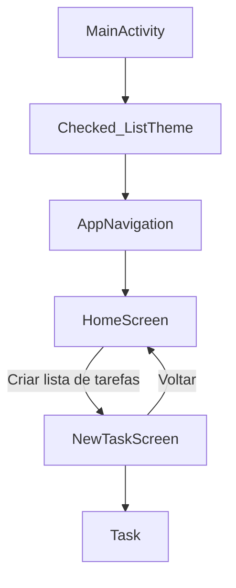

# Cuye List

Aplicativo Android para criar e marcar tarefas usando Jetpack Compose.

## Arquitetura

O projeto usa uma arquitetura simples orientada por responsabilidade:

<!-- A separação mantém a navegação, os dados e a interface independentes, facilitando a manutenção e a evolução do app. -->

```text
app/src/main/
├── AndroidManifest.xml
├── java/com/cuyelist/
│   ├── MainActivity.kt
│   ├── model/ 
│   │   └── Task.kt
│   ├── navigation/ ➞ navegação 
│   │   └── AppNavigation.kt
│   └── ui/
│       ├── screens/ ➞ telas 
│       │   ├── home/ ➞ principal 
│       │   │   └── HomeScreen.kt
│       │   └── task/ ➞ criar uma nova task 
│       │       └── NewTaskScreen.kt
│       └── theme/
│           ├── Color.kt
│           ├── Theme.kt
│           └── Type.kt
└── res/
    ├── drawable/
    ├── mipmap-*/
    ├── values/
    └── xml/
```

### Responsabilidades

- `MainActivity`: ponto de entrada Android. Inicializa o tema e chama a navegação.
- `navigation`: define as rotas e conecta as telas, mantendo a navegação fora da UI.
- `model`: contém os modelos de dados usados pelo aplicativo.
- `ui/screens`: contém as telas Compose organizadas por fluxo da aplicação.
- `ui/theme`: concentra cores, tipografia e configuração do tema Material 3.
- `res`: reúne recursos Android, como imagens, textos, temas e regras de backup.

## Fluxo da aplicação



A tela `NewTaskScreen` mantém a lista em memória enquanto está aberta. O modelo `Task` representa cada item e possui apenas os dados necessários para a interface: nome e estado concluído.

## Convenções

- Pacote-base: `com.cuyelist`.
- Pacotes e arquivos usam nomes em minúsculas; componentes Compose usam `PascalCase`.
- Cada tela recebe callbacks de navegação, evitando que a UI conheça detalhes do `NavController`.
- Rotas ficam centralizadas em `navigation/AppNavigation.kt`.
- Novas telas devem ser adicionadas em `ui/screens/<fluxo>/`.
- Modelos compartilhados devem ficar em `model/`.

## Como executar

Abra o projeto no Android Studio ou execute:

```bash
./gradlew :app:assembleDebug
```

Para validar apenas a compilação Kotlin:

```bash
./gradlew :app:compileDebugKotlin
```
