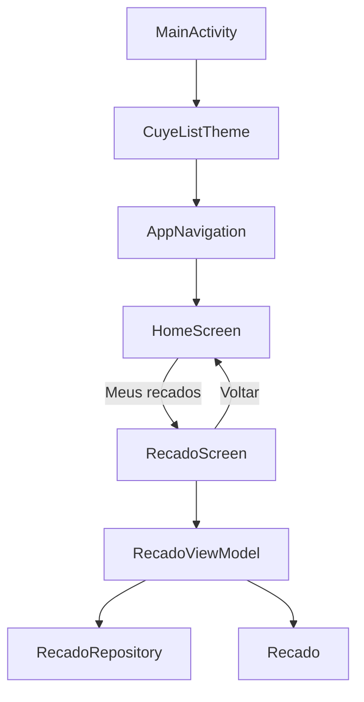

# Cuye List
<div align="center">

</div>

**Cuye List** é um aplicativo Android para anotar, priorizar e acompanhar seus recados (notas e tarefas), feito com Jetpack Compose.

<p>
  
  
  
  
  
  
  
</p>

- **Kotlin** + **Jetpack Compose** com **Material 3** para a interface.
- **Navigation Compose** para a navegação e **ViewModel** para o estado das telas.
- **SharedPreferences + JSON** para a persistência local.
- **Gradle (Kotlin DSL)** com catálogo de versões e **JUnit** para os testes unitários.

## Recursos

- Criar recados com **título**, **detalhes** opcionais e **prioridade** (baixa, média, alta).
- Marcar como concluído, **editar** e **excluir** (com opção de **desfazer**).
- **Busca** por título e detalhes, e filtros **Todos / Pendentes / Concluídos**.
- Ordenação automática: pendentes primeiro, depois prioridade e mais recentes.
- **Barra de progresso** com o total de recados concluídos.
- **Limpar concluídos** de uma só vez (também com desfazer).
- Visual novo: cabeçalho com gradiente e progresso, cards com faixa de prioridade, folha inferior para criar/editar e **deslizar para excluir**.
- **Compartilhar** um recado com outros apps.
- **Persistência local**: os recados continuam salvos ao fechar o app.

## Arquitetura

O projeto usa uma arquitetura simples orientada por responsabilidade (UI → ViewModel → repositório):

```text
app/src/main/java/com/cuyelist/
├── MainActivity.kt
├── data/
│   └── RecadoRepository.kt        ➞ persistência (SharedPreferences + JSON)
├── model/
│   └── Recado.kt                  ➞ Recado, Priority, RecadoFilter e regras de busca/ordenação
├── navigation/
│   └── AppNavigation.kt           ➞ rotas e navegação
└── ui/
    ├── screens/
    │   ├── home/HomeScreen.kt     ➞ tela inicial (mascote, resumo e atalho para os recados)
    │   └── recado/
    │       ├── RecadoScreen.kt    ➞ tela da lista: busca, filtros, swipe para excluir e desfazer
    │       ├── RecadoComponents.kt➞ cabeçalho com progresso, cards, estado vazio e folha de criar/editar
    │       └── RecadoViewModel.kt ➞ estado da tela e escrita no repositório
    └── theme/                     ➞ cores, tipografia e tema Material 3
```

### Responsabilidades

- `MainActivity`: ponto de entrada Android. Inicializa o tema e chama a navegação.
- `navigation`: define as rotas e conecta as telas, mantendo a navegação fora da UI.
- `model`: modelos de dados e regras puras (filtro, busca e ordenação), cobertas por testes unitários.
- `data`: salva e carrega os recados localmente.
- `ui/screens`: telas Compose organizadas por fluxo; o estado vive no `ViewModel`.
- `ui/theme`: concentra cores, tipografia e configuração do tema Material 3.

## Fluxo da aplicação



## Convenções

- Pacote-base: `com.cuyelist`.
- Pacotes e arquivos usam nomes em minúsculas; componentes Compose usam `PascalCase`.
- Cada tela recebe callbacks de navegação, evitando que a UI conheça detalhes do `NavController`.
- Rotas ficam centralizadas em `navigation/AppNavigation.kt`.
- Novas telas devem ser adicionadas em `ui/screens/<fluxo>/`.
- Modelos e regras puras ficam em `model/`; acesso a armazenamento em `data/`.

## Como executar

Abra o projeto no Android Studio ou execute:

```bash
./gradlew :app:assembleDebug
```

Para validar apenas a compilação Kotlin:

```bash
./gradlew :app:compileDebugKotlin
```


Para rodar os testes unitários:

```bash
./gradlew :app:testDebugUnitTest
```
